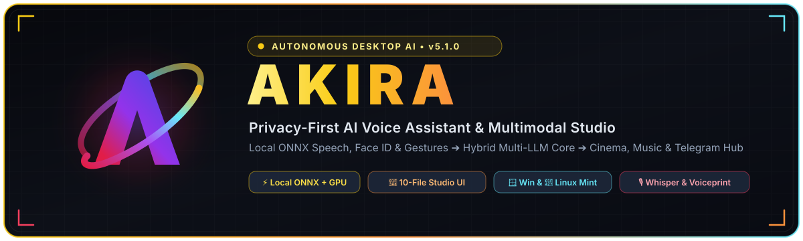
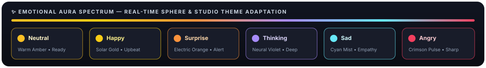
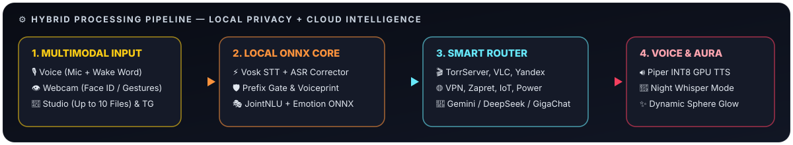

<p align="center">
  
</p>

<p align="center">
  <a href="https://github.com/RaccoonKa/Akira/releases"></a>
  
  
  
  
  
  <a href="https://creativecommons.org/licenses/by-nc-nd/4.0/"></a>
</p>

<p align="center">
  <b>Akira</b> is a cross-platform autonomous desktop AI assistant, creative multimodal Studio, and remote PC hub.<br>
  Engineered around a <b>hybrid privacy-first architecture</b>: offline ONNX speech recognition, NLU, face &amp; voice biometrics,<br>
  gesture control, sentiment analysis, and neural TTS run <b>100% locally on your hardware</b> — while deep reasoning,<br>
  multi-document analysis, and generative art/music tap into frontier cloud LLMs.
</p>

<p align="center">
  
</p>

<p align="center">
  
</p>

<p align="center">
  
</p>

<table>
  <tr>
    <td width="50%" valign="top">
      <h3>🎙️ Speech Pipeline, Whisper Mode &amp; Game Shield</h3>
      <ul>
        <li><b>Offline Vosk STT + ASR Neural Corrector:</b> Instant local voice transcription with post-correction and zero cloud lag.</li>
        <li><b>JointNLU &amp; Emotion Classifier (ONNX):</b> Intent routing and real-time emotional tone detection running locally on CUDA/DirectML/CPU.</li>
        <li><b>Piper INT8 Neural TTS:</b> GPU-accelerated synthesis with clause-level pacing, extensive orthoepic pronunciation dictionary, and automatic <b>Night Whisper Mode</b>.</li>
        <li><b>Game / Discord Anti-False-Trigger Filter:</b> Prefix gating + speech-continuity filter prevents accidental wake-ups during voice chat with teammates.</li>
        <li><b>Voiceprint Speaker Verification:</b> Acoustic biometrics verify the owner's voice and ignore background voices or speaker playback.</li>
      </ul>
    </td>
    <td width="50%" valign="top">
      <h3>🎨 Akira Studio &amp; Multimodal Generation</h3>
      <ul>
        <li><b>Modern PyQt6 Workspace:</b> Smooth inertial scrolling in both main chat and Studio, unified jitter-free expansion, SQLite history drawer with auto ID compaction, and real-time title generation.</li>
        <li><b>Multi-File Attachments (Up to 10 Files):</b> Attach up to <b>10 files simultaneously</b> via paperclip or Drag &amp; Drop (code, PDF, DOCX, logs, images) in a Gemini-style chip strip, while compact chat supports quick 1-file analysis.</li>
        <li><b>AI Art &amp; Image Synthesis:</b> Text-to-Image and multi-reference Image-to-Image via RouterAI with a 60 FPS digital ether shimmer, scan-line reveal, and inline viewer.</li>
        <li><b>48 kHz Neural Music Studio:</b> Stereo song generation with an emotion-colored audio visualizer, interactive waveform seek bar, and one-click MP3 export.</li>
        <li><b>Multi-LLM Core &amp; Guards:</b> Fluid switching between Gemini (<code>Hikari</code>, <code>Kasumi</code>, <code>Ginga</code>, <code>Uchū</code>), DeepSeek, GigaChat, and OpenAI — with response language guards, prompt-leak protection, and lazy ONNX tokenization for lean RAM.</li>
      </ul>
    </td>
  </tr>
  <tr>
    <td width="50%" valign="top">
      <h3>🎬 Torrent Cinema &amp; Yandex Music Hub</h3>
      <ul>
        <li><b>Direct Torrent Streaming:</b> Stream movies and TV series on demand via TorrServer without waiting for full downloads.</li>
        <li><b>Full VLC Voice Automation:</b> Switch episodes, audio tracks/dubs, subtitles, playback speed, and seek by exact timestamps.</li>
        <li><b>Yandex Music Integration:</b> <i>My Wave</i> without repeats, <i>Favorites</i>, named playlists, automatic continuation with <i>My Wave</i> after single-track requests, and dual-deck equal-power crossfade without startup volume spikes.</li>
        <li><b>Spotify, YouTube &amp; Media Keys:</b> Auto-fullscreen YouTube playback, Spotify controls, smart volume ducking when Akira speaks, and global media keys.</li>
      </ul>
    </td>
    <td width="50%" valign="top">
      <h3>👁️ Biometrics, Computer Vision &amp; Telegram Hub</h3>
      <ul>
        <li><b>Owner Face ID:</b> Recognizes the owner via webcam and delivers adaptive greetings based on how long you were away.</li>
        <li><b>Security Patrol &amp; Intruder Alerts:</b> Captures webcam snapshots of unrecognized users and sends an instant Telegram alert with a one-tap PC lock button.</li>
        <li><b>Touchless MediaPipe Gestures:</b> Open palm (play/pause), fist (lock screen), pointing finger (next track), plus blink/eye-fatigue break reminders.</li>
        <li><b>Telegram Remote Hub (aiogram 3.x):</b> Control power, system stats, and commands from your phone, monitor downloads with auto-shutdown, drop files directly to <code>Downloads/AkiraFiles</code>, and pair guests via dynamic QR codes.</li>
      </ul>
    </td>
  </tr>
  <tr>
    <td width="50%" valign="top">
      <h3>🌐 Network Automation &amp; Comfort Modes</h3>
      <ul>
        <li><b>Multi-Client VPN Control:</b> Voice-activated connect/disconnect for <b>Browsec</b>, <b>Sota Connect</b>, <b>Happ</b>, <b>V2Ray / Xray</b>, and <b>WireGuard</b>.</li>
        <li><b>Zapret (winws) DPI Bypass:</b> Instant strategy switching by voice with automatic recovery across VPN network changes.</li>
        <li><b>Persistent Game Mode &amp; Mini Mode:</b> Game Mode persists across restarts until manually disabled; Mini Mode collapses the UI into a compact floating orb.</li>
        <li><b>Alarms, Timers &amp; Reminders:</b> Natural language date/time parsing with background timers and missed-reminder recovery on boot.</li>
      </ul>
    </td>
    <td width="50%" valign="top">
      <h3>🎄 Lore RAG, Voice Games &amp; Holiday Easter Egg</h3>
      <ul>
        <li><b>Long-Term Memory &amp; Lore RAG:</b> Remembers preferences and context across sessions, and knows her own capabilities, shortcuts, and lore.</li>
        <li><b>Interactive Voice Games:</b> Play <i>Cities</i>, <i>Believe or Not</i> trivia, and detective <i>Danetki</i> with LLM refereeing.</li>
        <li><b>3-Act New Year Easter Egg:</b> Triggers at midnight (<code>Dec 31 → Jan 1</code>, including <code>00:00–00:29</code> wake-up) or once on first launch during <code>Jan 1–7</code>: ducks music, launches snowfall &amp; fireworks with chimes, speaks personalized greetings (separate warm scripts for regular users and the developer), and fades in holiday music.</li>
      </ul>
    </td>
  </tr>
</table>

<p align="center">
  
</p>

<p align="center">
  
</p>

<p align="center">
  
</p>

| Category | Example Voice Commands |
| :--- | :--- |
| **🎬 Cinema &amp; Torrents** | `"Akira, find Interstellar"` ➔ `"Play the next episode"` ➔ `"Switch audio track"` ➔ `"Rewind 30 seconds"` |
| **🎵 Music &amp; Media** | `"Play My Wave"` ➔ `"Like this track"` ➔ `"Next song"` ➔ `"Turn down the volume"` ➔ `"Toggle fullscreen"` |
| **⏳ Downloads &amp; Power** | `"Shut down PC when downloads finish"` ➔ `"Lock screen"` ➔ `"Restart computer"` ➔ `"Shutdown PC"` |
| **🌐 VPN &amp; Bypass** | `"Connect VPN"` ➔ `"Switch off Browsec"` ➔ `"Launch Zapret"` ➔ `"Set bypass strategy 7"` |
| **⏰ Time &amp; Memory** | `"Set an alarm for 7:30 AM"` ➔ `"Timer for 15 minutes"` ➔ `"Remind me tomorrow at 2 PM to call the doctor"` |
| **🎨 Studio &amp; Games** | `"Explain these attached files"` ➔ `"Generate synthwave cover art"` ➔ `"Let's play Cities"` |

<p align="center">
  
</p>

<p align="center">
  
</p>

| Layer | Technologies, Models &amp; Integrations |
| :--- | :--- |
| **🧠 Neural &amp; LLM** | Gemini API (`Hikari`, `Kasumi`, `Ginga`, `Uchū`), DeepSeek API, Sber GigaChat API, OpenAI API, RouterAI (`Nano Banana 2.1`, `Lyria 3 Pro Preview`), JointNLU (ONNX), Text Emotion Classifier, RapidOCR |
| **🎙️ Voice &amp; Audio** | Vosk STT, ASR Neural Corrector, Piper Neural TTS (INT8 ONNX), CUDA / DirectML Acceleration, Equal-Power Volume Ducker, Orthoepic Normalizer |
| **🎬 Video &amp; Music** | TorrServer Streaming Engine, VLC Player Controller, Yandex Music API, Spotify API, YouTube Data API |
| **👁️ Vision &amp; Biometrics** | Face ID (Dlib), MediaPipe Hand Gestures, Eye Fatigue &amp; Blink Tracker, Voiceprint Speaker Verification |
| **🌐 Network &amp; IoT** | Browsec, Happ GUI, Sota Connect, WireGuard, V2Ray / Xray, Zapret (`winws`), Yandex Smart Home IoT |
| **📱 Remote &amp; Storage** | Telegram Bot API (`aiogram 3.x`), FastAPI WebSocket Tunnel, Dynamic QR Guest Pairing, SQLite Studio DB |

<p align="center">
  
</p>

<p align="center">
  
</p>

> [!TIP]
> **Cross-Platform Auto-Updater &amp; Data Safety:** Akira checks GitHub Releases automatically, supports both single installers and **split `.part01`, `.part02` release assets** (&gt;2 GB GitHub limit workaround), and preserves all user configs, long-term memories, and SQLite Studio chats in `%APPDATA%\Akira` (Windows) or `~/.local/share/Akira` (Linux).

<details open>
<summary><b>🪟 Windows Installation (<code>.msi</code>)</b></summary>

1. Download `Akira-Setup-v5.1.0.msi` from [**GitHub Releases**](https://github.com/RaccoonKa/Akira/releases).
   - *If the release uses split parts (`.msi.part01`, `.msi.part02`, ...), download all parts into one folder, open `cmd` there, and combine them:*
     ```bat
     copy /b Akira-Setup-v5.1.0.msi.part* Akira-Setup-v5.1.0.msi
     ```
2. Open the `.msi` file and follow the installer wizard.

</details>

<details open>
<summary><b>🐧 Linux Mint / Ubuntu / Debian Installation (<code>.deb</code>)</b></summary>

1. Download all `.deb.part*` files (`akira_5.1.0_amd64.deb.part01`, `akira_5.1.0_amd64.deb.part02`, ...) from [**GitHub Releases**](https://github.com/RaccoonKa/Akira/releases) into the same folder.
2. Open a terminal in that folder, merge the parts, and install:
   ```bash
   cat akira_5.1.0_amd64.deb.part* > akira_5.1.0_amd64.deb && sudo apt install -y ./akira_5.1.0_amd64.deb
   ```
3. To uninstall later (your personal configs and chats in `~/.local/share/Akira` stay intact):
   ```bash
   sudo apt remove -y akira
   ```

</details>

<details>
<summary><b>🛠️ Build from Source (Nuitka)</b></summary>

```bash
# Windows (Nuitka + WiX .msi)
.venv\Scripts\python.exe build_nuitka.py

# Linux Mint / Ubuntu (Nuitka + .deb, auto-splits >1.81 GiB assets for GitHub Releases)
.venv/bin/python build_nuitka.py --platform linux --format deb
```

</details>

---

<p align="center">
  <b>📄 License:</b> <a href="https://creativecommons.org/licenses/by-nc-nd/4.0/">CC BY-NC-ND 4.0</a> (Attribution-NonCommercial-NoDerivatives 4.0 International) • Crafted by <b>Svetozar (RaccoonKa)</b>
</p>
