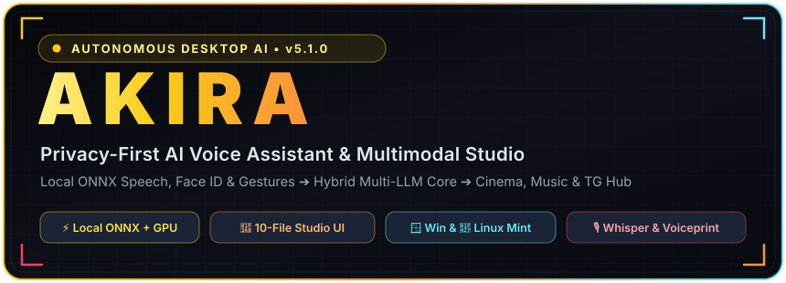

<p align="center">
  
</p>

<p align="center">
  <a href="https://github.com/RaccoonKa/Akira/releases"></a>
  
  
  
  
  <a href="https://creativecommons.org/licenses/by-nc-nd/4.0/"></a>
</p>

<p align="center">
  <b>Akira</b> is a cross-platform autonomous desktop AI assistant, multimodal Studio, and remote PC hub.<br>
  Built on a <b>hybrid privacy-first architecture</b>: offline ONNX speech, biometrics, and neural TTS run <b>100% locally</b>,<br>
  while deep reasoning, document analysis, and media synthesis tap into frontier LLMs.
</p>

<p align="center">
  
</p>

<p align="center">
  
</p>

<p align="center">
  
</p>

<table>
  <tr>
    <td width="50%" valign="top">
      <h3>🎙️ Speech Pipeline &amp; Game-Chat Shield</h3>
      <ul>
        <li><b>Offline Vosk STT + JointNLU:</b> Instant local command recognition with zero cloud latency.</li>
        <li><b>Piper INT8 Neural TTS (GPU):</b> Natural pacing, orthoepic dictionary, and automatic <b>Night Whisper Mode</b>.</li>
        <li><b>Prefix Gate &amp; Voiceprint:</b> Filters out Discord teammates and speaker audio so Akira only responds to you.</li>
      </ul>
    </td>
    <td width="50%" valign="top">
      <h3>🎨 Akira Studio &amp; Multimodal AI</h3>
      <ul>
        <li><b>10-File Attachments:</b> Attach up to <b>10 files at once</b> via paperclip or Drag &amp; Drop (code, PDF, DOCX, logs, images) in Studio, plus 1-file quick chat.</li>
        <li><b>Image &amp; Music Synthesis:</b> RouterAI Text-to-Image / Image-to-Image with 60 FPS ether shimmer, plus 48 kHz neural music with interactive waveform seek &amp; MP3 export.</li>
        <li><b>Multi-LLM Core:</b> Seamless switching between Gemini (<code>Hikari</code>, <code>Kasumi</code>, <code>Ginga</code>, <code>Uchū</code>), DeepSeek, GigaChat, and OpenAI with prompt-leak &amp; language guards.</li>
      </ul>
    </td>
  </tr>
  <tr>
    <td width="50%" valign="top">
      <h3>🎬 Torrent Cinema &amp; Yandex Music</h3>
      <ul>
        <li><b>Direct Torrent Streaming:</b> Stream movies &amp; series via TorrServer + VLC without waiting for downloads.</li>
        <li><b>VLC Voice Control:</b> Episode switching, audio tracks, subtitles, speed, and exact time seeking.</li>
        <li><b>Yandex Music Crossfade:</b> Deduplicated <i>My Wave</i>, <i>Favorites</i>, named playlists, auto-continuation after single tracks, and equal-power dual-deck crossfade.</li>
      </ul>
    </td>
    <td width="50%" valign="top">
      <h3>👁️ Biometrics, Vision &amp; Telegram Hub</h3>
      <ul>
        <li><b>Owner Face ID &amp; Patrol:</b> Adaptive greetings when you sit down; intruder webcam snapshots sent to Telegram with one-tap PC lock.</li>
        <li><b>Touchless MediaPipe Gestures:</b> Open palm (play/pause), fist (lock screen), pointing (next track), plus eye-fatigue alerts.</li>
        <li><b>Telegram Remote Hub:</b> Control power, monitor downloads with auto-shutdown, drop files from phone to <code>Downloads/AkiraFiles</code>, and pair guests via QR.</li>
      </ul>
    </td>
  </tr>
  <tr>
    <td width="50%" valign="top">
      <h3>🌐 Network, VPN &amp; Comfort Modes</h3>
      <ul>
        <li><b>VPN Automation:</b> Voice control for Browsec, Sota Connect, Happ, V2Ray/Xray, and WireGuard.</li>
        <li><b>Zapret (winws) Strategies:</b> Instant DPI bypass switching with auto-recovery on network changes.</li>
        <li><b>Persistent Game &amp; Mini Mode:</b> Game Mode stays active across restarts; Mini Mode collapses to a floating orb.</li>
      </ul>
    </td>
    <td width="50%" valign="top">
      <h3>🎄 Lore RAG, Games &amp; Holiday Easter Egg</h3>
      <ul>
        <li><b>Long-Term Memory &amp; Lore RAG:</b> Remembers context across sessions and knows her own capabilities and lore.</li>
        <li><b>Voice Games:</b> Play <i>Cities</i>, <i>Believe or Not</i>, and <i>Danetki</i> with interactive LLM refereeing.</li>
        <li><b>3-Act New Year Easter Egg:</b> Triggers at midnight (<code>Dec 31 → Jan 1</code>) or first launch during <code>Jan 1–7</code> with snowfall, fireworks, chimes, personalized greetings, and holiday music.</li>
      </ul>
    </td>
  </tr>
</table>

<p align="center">
  
</p>

<p align="center">
  
</p>

<p align="center">
  
</p>

| Category | Example Voice Commands |
| :--- | :--- |
| **🎬 Cinema &amp; Torrents** | `"Akira, find Interstellar"` ➔ `"Next episode"` ➔ `"Switch audio track"` ➔ `"Rewind 30 seconds"` |
| **🎵 Music &amp; Media** | `"Play My Wave"` ➔ `"Like this track"` ➔ `"Next song"` ➔ `"Turn down the volume"` ➔ `"Toggle fullscreen"` |
| **⏳ Downloads &amp; Power** | `"Shut down PC when downloads finish"` ➔ `"Lock screen"` ➔ `"Restart computer"` |
| **🌐 VPN &amp; Bypass** | `"Connect VPN"` ➔ `"Turn off Browsec"` ➔ `"Launch Zapret"` ➔ `"Select strategy 7"` |
| **⏰ Time &amp; Memory** | `"Set an alarm for 7:30 AM"` ➔ `"Timer for 15 minutes"` ➔ `"Remind me tomorrow at 2 PM"` |
| **🎨 Studio &amp; Games** | `"Explain these attached files"` ➔ `"Generate synthwave cover art"` ➔ `"Let's play Cities"` |

<p align="center">
  
</p>

<p align="center">
  
</p>

> [!TIP]
> **Seamless Auto-Updates &amp; Data Safety:** Akira checks GitHub Releases automatically, supports **split `.part01`, `.part02` release assets** (>2 GB workaround), and preserves all configs, memories, and SQLite Studio chats in `%APPDATA%\Akira` (Windows) or `~/.local/share/Akira` (Linux).

<details open>
<summary><b>🪟 Windows Installation (<code>.msi</code>)</b></summary>

1. Download `Akira-Setup-v5.1.0.msi` from [**GitHub Releases**](https://github.com/RaccoonKa/Akira/releases).
   - *If the release uses split parts (`.msi.part01`, `.msi.part02`, ...), download all parts into one folder, open `cmd` there, and merge them:*
     ```bat
     copy /b Akira-Setup-v5.1.0.msi.part* Akira-Setup-v5.1.0.msi
     ```
2. Run the `.msi` installer and follow the setup wizard.

</details>

<details open>
<summary><b>🐧 Linux Mint / Ubuntu / Debian Installation (<code>.deb</code>)</b></summary>

1. Download all `.deb.part*` files (`akira_5.1.0_amd64.deb.part01`, `akira_5.1.0_amd64.deb.part02`, ...) from [**GitHub Releases**](https://github.com/RaccoonKa/Akira/releases) into one folder.
2. Open a terminal in that folder, merge the parts, and install:
   ```bash
   cat akira_5.1.0_amd64.deb.part* > akira_5.1.0_amd64.deb && sudo apt install -y ./akira_5.1.0_amd64.deb
   ```
3. To uninstall later (keeps your configs in `~/.local/share/Akira`):
   ```bash
   sudo apt remove -y akira
   ```

</details>

<details>
<summary><b>🛠️ Build from Source (Nuitka)</b></summary>

```bash
# Windows
.venv\Scripts\python.exe build_nuitka.py

# Linux Mint / Ubuntu (builds .deb + .tar.gz and auto-splits >1.81 GiB assets for GitHub Releases)
.venv/bin/python build_nuitka.py --platform linux --format deb
```

</details>

---

<p align="center">
  <b>📄 License:</b> <a href="https://creativecommons.org/licenses/by-nc-nd/4.0/">CC BY-NC-ND 4.0</a> (Attribution-NonCommercial-NoDerivatives) • Crafted by <b>Svetozar (RaccoonKa)</b>
</p>
