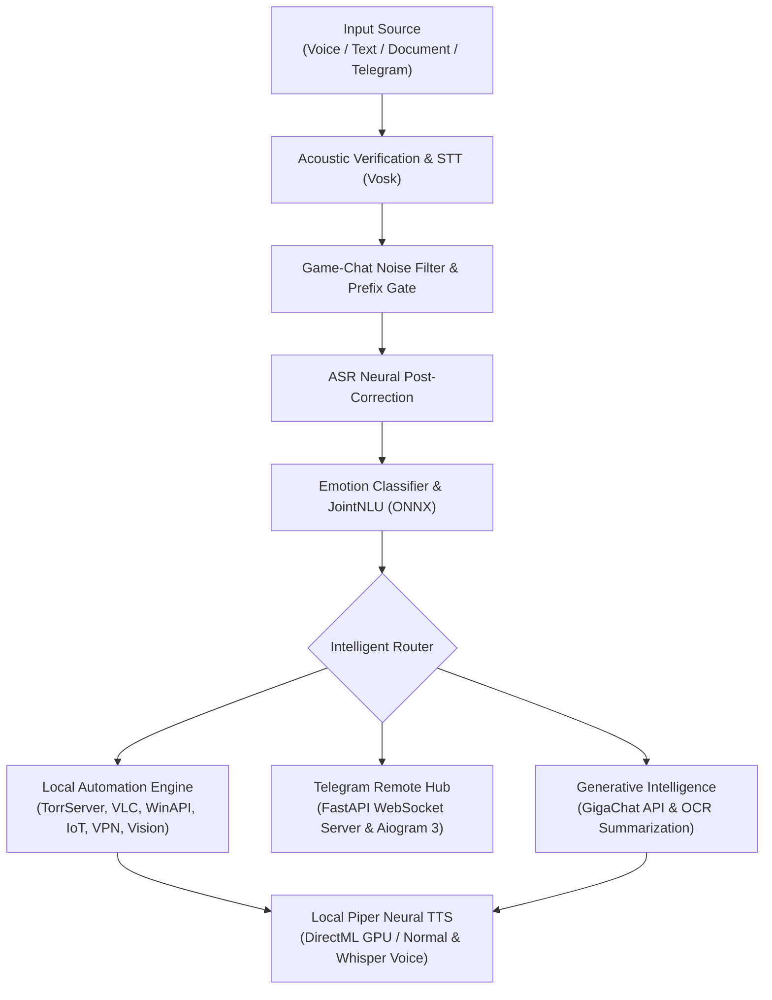
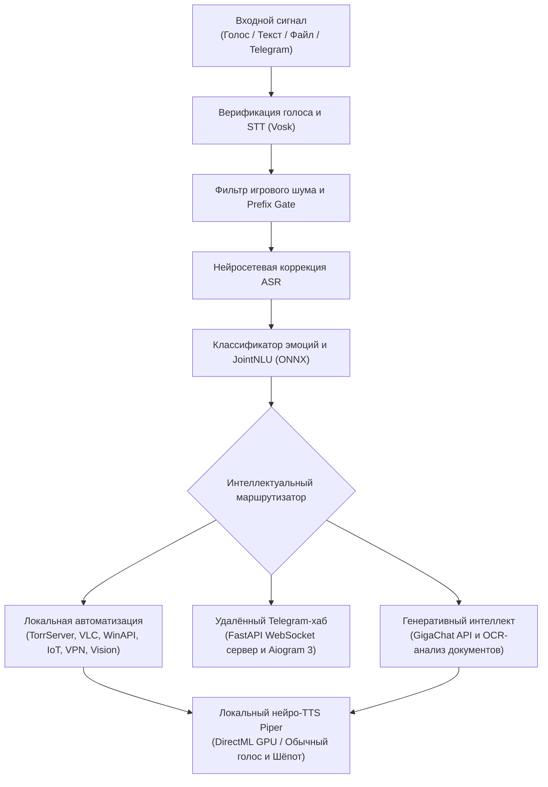

# 🌟 Akira — AI Voice Assistant & Desktop Copilot

  

  <b>A next-generation personal autonomous voice assistant and remote PC hub for Windows</b> 
  Combines an offline local NLU pipeline, low-latency neural TTS (Piper with whisper mode), computer vision, torrent streaming cinema, and remote control via Telegram.

  
  
  
  
  
  

---

## EN Version

---

## 📌 About the Project

**Akira** is an intelligent desktop assistant and management hub engineered for comprehensive voice, gesture, and remote smartphone control over your PC, multimedia, home network, and IoT ecosystem.

Unlike traditional cloud assistants, Akira utilizes a **hybrid privacy-first architecture**: critical tasks (STT, intent classification, face biometrics, hand gestures, sentiment analysis, audio ducking, and neural speech synthesis) execute **100% locally via quantized ONNX models**, while complex generative queries and deep document analysis leverage the **GigaChat API**.

---

## ✨ Key Features

### 🎙️ Speech Pipeline, Whisper Mode & Game-Chat Shield
* **Offline STT & JointNLU:** Instant voice transcription using Vosk and an in-house JointNLU encoder with zero cloud lag.
* **Neural TTS with Whisper Mode:** Powered by quantized INT8 Piper models accelerated with DirectML/GPU. Features dynamic switching to a specialized whisper voice model for night-time interaction.
* **Game/Discord Anti-False-Trigger Filter:** Incorporates prefix gating and speech-continuity filters to prevent false wake-ups during Discord calls and gaming sessions.
* **Voiceprint & Speaker Verification:** Biometric acoustic identification verifying the owner's voice and filtering out background voices from teammates or speakers.

### 🎬 Torrent Streaming Cinema & Media Hub
* **Direct Torrent Streaming:** Instant playback of movies and TV series via TorrServer without waiting for the full file to download.
* **VLC Automation:** Voice-controlled episode switching, subtitle toggles, audio track/dubbing changes, playback speed adjustment, and precise time seeking.
* **Music & Media Control:** Native support for Yandex Music ("My Wave", likes/dislikes), Spotify, YouTube auto-fullscreen, and global media keys.

### 📱 Remote Telegram Hub & File Bridge
* **Remote Management Hub:** Control your desktop from smartphone via Telegram bot with categorized command keyboards.
* **Download Watcher & Auto-Shutdown:** Tracks network receiving and SSD write activity. Notifies when game/file downloads complete and shuts down the PC after a safety countdown.
* **Phone-to-PC File Drop:** Send any documents, media, or archives directly to the Telegram bot to have them saved immediately to `Downloads/AkiraFiles` on your computer.
* **Multi-User Hub & Owner Administration:** Supports guest pairing via dynamic QR-code with remote moderation panels for the primary owner.

### 👁️ Biometrics & Vision
* **Owner Face ID:** Auto-detects the owner upon sitting in front of the camera and welcomes them back with adaptive greetings.
* **Security Patrol & Intruder Alerts:** Captures webcam snapshots of unrecognized users and sends an alert with a lock-screen button directly to Telegram.
* **Media Gestures:** Touchless MediaPipe gesture control (open palm to pause/play, fist to lock Windows, pointing to skip track).
* **Eye Fatigue & Health Monitoring:** Evaluates blink patterns and prolonged eye closure to suggest rest breaks.

### 🌐 Network & Bypass Controls
* **VPN Client Automation:** Voice-driven connection management for **Sota Connect**, **Happ**, **V2Ray/Xray**, and **WireGuard**.
* **Zapret (winws) Strategies:** Voice-activated DPI bypass switching with auto-recovery across VPN network changes.

### 🎮 Games, Reminders & Time Management
* **Voice Games:** Play *Cities*, *Believe or Not* trivia, and detective *Danetki* riddles with interactive LLM refereeing.
* **Alarms, Timers & Reminders:** Natural language date/time parsing with background timers, wake-up alarms, and missed reminder tracking.

---

## 🗣️ Example Voice Commands

| Category | Example Commands |
| :--- | :--- |
| **🎬 Cinema & Torrents** | "Akira, find the movie Interstellar", "Play the next episode", "Switch audio track", "Rewind 30 seconds" |
| **🎵 Music & Media** | "Play My Wave", "Like this track", "Next song", "Turn down the volume", "Toggle fullscreen" |
| **⏳ Downloads & Power** | "Turn off the PC when downloads finish", "Lock screen", "Restart computer", "Shutdown PC" |
| **🌐 VPN & Bypass** | "Connect VPN", "Switch off Sota", "Launch Zapret", "Set bypass strategy 7" |
| **⏰ Time & Tasks** | "Set an alarm for 7:30 AM", "Set a timer for 15 minutes", "Remind me tomorrow at 2 PM to call the doctor" |
| **🎲 Games & Chat** | "Let's play Cities", "Tell me the rules of Danetki", "Explain this attached document" |

---

## ⚙️ Architecture & Processing Pipeline

---

## 🔌 Supported Services and Ecosystem

| Category | Services and Modules |
| --- | --- |
| **Neural Intelligence** | Sber GigaChat API, JointNLU (ONNX), Text Emotion Classifier, RapidOCR |
| **Voice & Audio** | Vosk STT, Piper Neural TTS (INT8 ONNX), DirectML Provider, Volume Ducker |
| **Video & Streaming** | TorrServer Engine, VLC Player Controller, YouTube Data API |
| **Network Clients & VPN** | Happ GUI, Sota Connect, WireGuard, V2Ray / Xray, Zapret (WinWS) |
| **Multimedia & IoT** | Yandex Music API, Spotify API, Yandex Smart Home IoT |
| **Vision & Biometrics** | Face ID (Dlib), MediaPipe Gestures, Eye Fatigue & Blink Tracker |
| **Remote Control** | Telegram Bot API (aiogram 3.x), Persistent WebSocket Tunnel |

---

## 📄 License

This project is distributed under the [CC BY-NC 4.0](https://creativecommons.org/licenses/by-nc/4.0/) license. Non-commercial use, study, and modification are permitted with mandatory attribution.

---

## RU Версия

---

## 📌 О проекте

**Akira** — это модульный десктопный ассистент и центр удалённого управления, созданный для полноценного голосового, жестового и мобильного контроля над вашим ПК, мультимедиа, домашней сетью и умными устройствами.

В отличие от стандартных облачных решений, Akira построена на **гибридной архитектуре с акцентом на приватность**: критические задачи (распознавание речи, классификация интентов NLU, верификация голоса, Face ID, жесты, анализ эмоций и нейросетевой синтез речи) выполняются **локально с помощью квантованных ONNX-моделей**, а генеративные диалоги и обработка документов поручены интеллекту **GigaChat API**.

---

## ✨ Ключевые возможности

### 🎙️ Речевой конвейер, режим шёпота и защита от ложных срабатываний

* **Офлайн STT и JointNLU:** Мгновенное локальное распознавание команд через Vosk и собственную модель JointNLU без сетевых задержек.
* **Нейросетевой TTS с поддержкой шёпота:** Локальный синтез речи на базе моделей Piper (INT8) с аппаратным ускорением DirectML/GPU. Поддерживает автоматический переход на специальную модель шёпота в ночное время.
* **Фильтр разговоров в играх и Discord:** Архитектура Prefix Gate и анализ связности речи отсекают реплики, сказанные в войс-чат тиммейтам, предотвращая случайные вмешательства ассистента.
* **Биометрия голоса (Speaker Verification):** Идентификация тембра владельца, отсекающая посторонние голоса и звуки из колонок.

### 🎬 Торрент-кинотеатр и мультимедиа

* **Потоковый просмотр торрентов:** Воспроизведение фильмов и сериалов через TorrServer без необходимости предварительного скачивания файлов на диск.
* **Управление плеером VLC:** Голосовое переключение серий, выбор аудиодорожек и озвучек, управление субтитрами, регулировка скорости и точная перемотка.
* **Музыка и стриминг:** Встроенная поддержка Яндекс Музыки («Моя волна», управление лайками), Spotify и авторазворачивание YouTube-видео на весь экран.

### 📱 Удалённый Telegram-хаб и передача файлов

* **Центр управления в смартфоне:** Удобная навигация по категориям (Мониторинг, Питание, Закачки, Возможности) через Telegram-бота.
* **Сторож закачек и автовыключение:** Мониторинг входящего интернет-трафика и активности записи на диск. После завершения скачивания и распаковки присылает пуш-уведомление и безопасно выключает ПК по таймеру.
* **Быстрый сброс файлов на ПК:** Отправьте любой документ, фото, видео или архив боту в Telegram — Акира мгновенно сохранит его в папку `Загрузки/AkiraFiles` на вашем компьютере.
* **Многопользовательский режим и администрирование:** Привязка ПК по динамическому QR-коду и панель создателя для просмотра статуса сети и модерации доступа.

### 👁️ Биометрия и компьютерное зрение

* **Face ID владельца:** Приветствие при возвращении за рабочее место с адаптивными репликами в зависимости от времени отсутствия.
* **Охранный режим:** Автоматическая фиксация посторонних перед веб-камерой и отправка фото-тревоги в Telegram с кнопкой мгновенной блокировки ПК.
* **Бесконтактные жесты:** Управление мультимедиа через MediaPipe (пауза ладонью, блокировка экрана кулаком, переключение трека указательным пальцем).
* **Контроль усталости глаз:** Отслеживание частоты моргания и закрытия глаз с предупреждениями об отдыхе.

### 🌐 Сеть, VPN и обход блокировок

* **Автоматизация VPN-клиентов:** Голосовое подключение и смена серверов для **Sota Connect**, **Happ**, **V2Ray/Xray** и **WireGuard**.
* **Стратегии Zapret (winws):** Быстрое переключение конфигураций обхода DPI с автоматическим сохранением стабильного соединения при смене сетевых маршрутов.

### 🎮 Игры, таймеры и управление временем

* **Голосовые игры:** Полноценные сессии в «Города», «Верю — не верю» и «Данетки» с судейством через LLM.
* **Будильники, таймеры и напоминания:** Распознавание естественной речи для установки будильников, таймеров и задач с сохранением пропущенных напоминаний после включения ПК.

---

## 🗣️ Примеры голосовых команд

| Категория | Примеры команд |
| --- | --- |
| **🎬 Кинотеатр и видео** | "Акира, найди фильм Интерстеллар", "Следующая серия", "Смени озвучку", "Перемотай на 20 секунд назад" |
| **🎵 Музыка и звук** | "Включи мою волну", "Лайкни этот трек", "Следующая песня", "Сделай потише", "Разверни на весь экран" |
| **⏳ Закачки и питание** | "Выключи компьютер, когда всё скачается", "Заблокируй экран", "Перезагрузи ПК", "Выключи компьютер" |
| **🌐 VPN и обход** | "Включи VPN", "Отключи Sota", "Запусти Zapret", "Выбери седьмой обход" |
| **⏰ Время и задачи** | "Поставь будильник на 7:30 утра", "Поставь таймер на 15 минут", "Напомни завтра в два часа дня сходить в банк" |
| **🎲 Игры и файлы** | "Давай сыграем в Данетки", "Расскажи правила игры в Города", "Изучи прикреплённый документ" |

---

## ⚙️ Архитектура и конвейер обработки

---

## 🔌 Поддерживаемые сервисы и экосистема

| Категория | Сервисы и модули |
| --- | --- |
| **Нейросетевой интеллект** | Sber GigaChat API, JointNLU (ONNX), Text Emotion Classifier, RapidOCR |
| **Голос и синтез** | Vosk STT, Piper Neural TTS (INT8 ONNX), DirectML Provider, Volume Ducker |
| **Видео и стриминг** | Движок TorrServer, контроллер плеера VLC, YouTube Data API |
| **Сетевые клиенты и VPN** | Happ GUI, Sota Connect, WireGuard, V2Ray / Xray, Zapret (WinWS) |
| **Мультимедиа и IoT** | Yandex Music API, Spotify API, Умный дом с Алисой (IoT) |
| **Зрение и биометрия** | Face ID (Dlib), жесты MediaPipe, трекинг моргания и усталости глаз |
| **Удалённый доступ** | Telegram Bot API (aiogram 3.x), постоянный WebSocket-туннель |

---

## 🛡️ Приватность и локальность данных

* **Локальная биометрия:** Распознавание лица, голосовые отпечатки владельца, трекинг глаз и жестовое управление производятся строго локально. Видео- и аудиопотоки не передаются на внешние серверы.
* **Изолированное хранение данных:** Токены, конфигурации и пользовательские файлы хранятся на локальном диске в каталогах `personal_data/` и `Downloads/AkiraFiles/`.

---

## 📄 Лицензия

Проект распространяется под лицензией [CC BY-NC 4.0](https://creativecommons.org/licenses/by-nc/4.0/). Разрешено некоммерческое использование, изучение и модификация с обязательным указанием авторства.